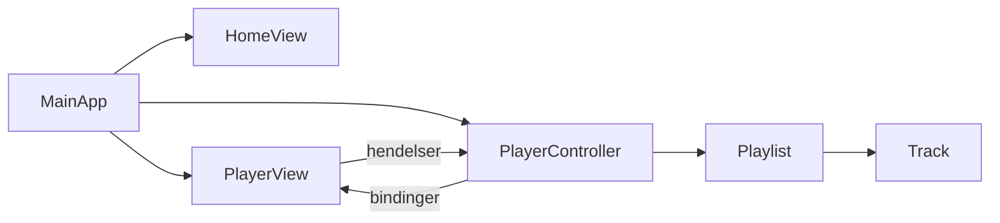

# Smart Multimedia Hub

En JavaFX-applikasjon for å spille av lyd- og videofiler. Appen har en spilleliste, avspillingskontroller og fremdrift og volum som oppdateres mens et spor spilles.

Laget som **Prosjekt 3** i **OBJ2000 Obligatorisk oppgave 2**, Objektorientert programmering 1, USN.

---

## Innhold

- [Funksjoner](#funksjoner)
- [Teknologi](#teknologi)
- [Prosjektstruktur](#prosjektstruktur)
- [Hva skal hvor](#hva-skal-hvor)
- [Oppsett og kjøring](#oppsett-og-kjøring)
- [Arkitektur](#arkitektur)
- [Milepæler](#milepæler)
- [Innlevering](#innlevering)

---

## Funksjoner

- Ferdig spilleliste med minst tre mediefiler ved oppstart
- Spill av, pause, stopp, neste og forrige spor
- Fremdriftslinje og tidsetikett som oppdateres automatisk med bindinger
- Volumslider som er bundet til `MediaPlayer.volumeProperty()`
- Sporet som spilles fremheves i listen, sammen med en «Spilles nå»-tekst
- Bytte mellom hjemskjerm og spiller
- Feilmelding hvis en fil mangler eller ikke kan spilles
- Avspillingen stopper når et spor er ferdig
- Layout som tilpasser seg vindusstørrelsen

## Teknologi

| Verktøy  | Versjon |
|----------|---------|
| JDK      | 25      |
| JavaFX   | 25.0.4 (moduler: `javafx.controls`, `javafx.media`) |
| Editor   | VS Code med Extension Pack for Java |

Hele grensesnittet bygges i Java-kode. Prosjektet bruker ikke FXML.

## Prosjektstruktur

```
FX/
├── .vscode/
│   └── settings.json          # JDK, JavaFX-bibliotek, kildemappe og out-mappe
├── docs/                      # Oppgavetekster (PDF)
├── out/                       # Kompilerte .class-filer (lages automatisk)
├── src/
│   ├── prosjektpakke/
│   │   ├── MainApp.java       # Startpunkt, bytter mellom skjermer
│   │   ├── controller/
│   │   │   └── PlayerController.java
│   │   ├── model/
│   │   │   ├── Track.java
│   │   │   └── Playlist.java
│   │   ├── view/
│   │   │   ├── HomeView.java
│   │   │   └── PlayerView.java
│   │   └── resources/
│   │       └── media/         # Lyd- og videofiler
│   └── sample/
│       └── HelloFX.java       # Bare for å teste at JavaFX fungerer
└── README.md
```

## Hva skal hvor

| Mappe / fil | Ansvar | Inneholder |
|-------------|--------|------------|
| `MainApp.java` | Oppstart | Starter JavaFX, lager modell, kontroller og visninger, og bytter scene |
| `model/` | Data | Rene dataklasser med JavaFX-properties. Ingen GUI-kode her. |
| `view/` | Utseende | Layout med `BorderPane`, `VBox` og `HBox`. Bare oppbygging av kontroller, ingen avspillingslogikk. |
| `controller/` | Logikk | `MediaPlayer`, hendelser fra knapper og slidere, og bindinger mellom modell og visning |
| `resources/media/` | Medier | Korte `.mp3`-, `.wav`-, `.m4a`- eller `.mp4`-filer (H.264) |
| `out/` | Bygg | Lages av VS Code. Skal ikke redigeres eller sjekkes inn. |
| `docs/` | Dokumentasjon | Oppgavetekster, designbeskrivelse |

**Tommelfingerregel:** `view` vet hvordan noe *ser ut*, `model` vet hva som *er*, og `controller` bestemmer hva som *skjer*.

## Oppsett og kjøring

### Krav
1. JDK 25 installert i `C:/Program Files/Java/jdk-25.0.4.1`
2. JavaFX SDK pakket ut i `C:/javafx-windows/javafx-sdk-25.0.4`

Begge stiene er satt i [.vscode/settings.json](.vscode/settings.json). Endre dem hvis JDK eller JavaFX ligger et annet sted på maskinen din.

### Kjøre i VS Code
1. Åpne mappen `FX/` i VS Code.
2. Åpne `src/prosjektpakke/MainApp.java`.
3. Trykk **Run** over `main`-metoden, eller trykk `F5`.

> `java.debug.settings.vmArgs` må inneholde `javafx.media` i `--add-modules` for at `MediaPlayer` skal fungere.

### Kjøre fra terminal
```powershell
$fx = "C:/javafx-windows/javafx-sdk-25.0.4/lib"
javac -d out --module-path $fx --add-modules javafx.controls,javafx.media (Get-ChildItem -Recurse src/prosjektpakke -Filter *.java).FullName
Copy-Item -Recurse src/prosjektpakke/resources out/prosjektpakke/ -Force
java --module-path $fx --add-modules javafx.controls,javafx.media -cp out prosjektpakke.MainApp
```

### Legge til mediefiler
1. Legg filene i `src/prosjektpakke/resources/media/`.
2. Bruk korte, enkle filnavn uten mellomrom eller æøå, for eksempel `spor1.mp3`.
3. Last dem inn via classpath, slik at stiene fungerer på alle maskiner:
   `getClass().getResource("/prosjektpakke/resources/media/spor1.mp3")`

## Arkitektur



**Dataflyt:** brukeren klikker i `PlayerView`. Kontrolleren oppdaterer `MediaPlayer` og `Playlist`. Bindinger sørger for at visningen oppdateres automatisk, uten manuell oppdateringslogikk.

## Milepæler

- [ ] **1. Oppsett og layout:** hovedvindu med plassholdere, bytte mellom hjem- og spillerskjermen
- [ ] **2. Medieintegrasjon:** spill av én fil
- [ ] **3. Spilleliste og valg:** valgt spor spilles av
- [ ] **4. Kontroller og hendelser:** spill av, pause, stopp, neste, forrige og volum
- [ ] **5. Bindinger:** fremdrift, tid og «Spilles nå» oppdateres automatisk
- [ ] **6. Visuell tilbakemelding:** fremhev aktivt spor, statusfarger
- [ ] **7. Integrasjon og testing:** feilhåndtering, endring av vindusstørrelse, finpuss

## Innlevering

| Fil | Innhold |
|-----|---------|
| `GruppeID.zip` | All kildekode og alle ressurser (uten `out/`) |
| `GruppeID.pdf` | Designbeskrivelse (1–2 sider): struktur, dataflyt, grensesnittdesign, fremtidige forbedringer og eget bidrag |
| `GruppeID.mp4` | Video på omtrent 30 sekunder som viser appen |

Vurderingen ser på funksjonalitet, bruk av JavaFX-prinsipper (hendelser, bindinger, struktur), kvaliteten på grensesnittet og kodekvalitet.
